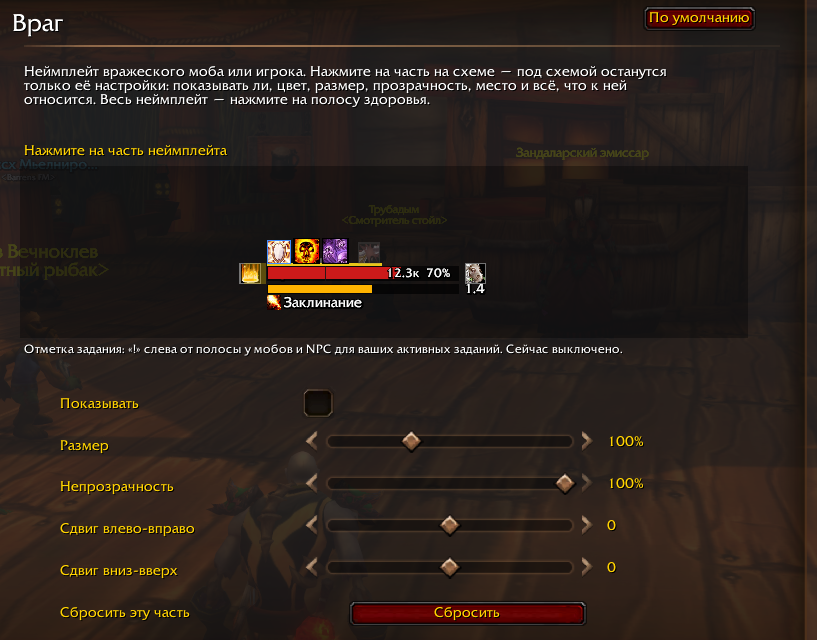
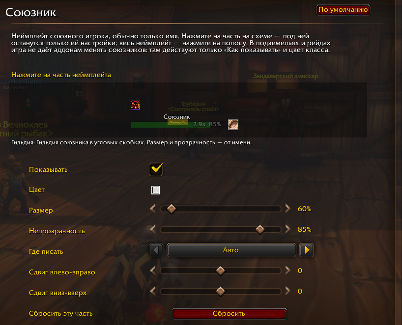

# ForeverPlates 0.12.3

Тонкая настройка стандартных неймплейтов WoW Forever в их родном стиле — и, по желанию, текста на фреймах игрока и цели. Аддон ничего не перерисовывает: он выставляет встроенные настройки игры, добавляет несколько элементов к стандартным неймплейтам и даёт подогнать размер, прозрачность и место каждой части.

Название аддона, папка и репозиторий на GitHub совпадают: `ForeverPlates`.

| Враг | Союзник | Фреймы |
|---|---|---|
|  |  |  |

## Установка

Распакуйте папку `ForeverPlates` в `World of Warcraft\_forever_\Interface\AddOns\` (там же, где лежат другие аддоны Forever). Отключите Plater: два аддона неймплейтов мешают друг другу.

## Как устроены настройки

`Esc → Настройки → Модификации → ForeverPlates`, `/fpl`, кнопка у миникарты (клик — настройки, перетаскивание — переместить) или кнопка аддонов рядом с миникартой.

- **ForeverPlates** (главная) — пресет, сброс своих правок, кнопка у миникарты, управление настройками игры и то, что общее для всех неймплейтов: показывать ли их всегда, держать ли у края экрана, бледнеют ли за препятствиями.
- **Враг**, **Союзник**, **Питомец союзника** — на каждой странице схема этого неймплейта. Нажимаете на часть — и под схемой остаются только её настройки: показывать ли, цвет, размер, непрозрачность, сдвиг, место и всё, что к ней относится. Выключенные части нарисованы на схеме бледно. У каждой части есть «Сбросить эту часть».

- **Фреймы** — ваш фрейм, цель и цель цели: что писать на полосах здоровья и маны (по отдельности для каждой полосы), когда (всегда, в бою, вне боя) и каким размером. Пока у полосы стоит «Как в игре» (так по умолчанию), аддон её не трогает.

Части врага: весь неймплейт (дальность появления, раздвигание, бледнее вне досягаемости и не в цели, каких врагов показывать), имя (цвет, над полосой или внутри неё), гильдия, цифры здоровья, подсветка агро, отметка добивания, полоса каста, название заклинания, время каста, мои дебаффы, баффы, которые можно снять, значки игры (баффы слева, дебаффы над именем, контроль справа), отметка задания.
Части союзника: весь неймплейт (только имя или с полоской), имя, гильдия, цифры здоровья, дебаффы, которые можно снять, значки игры. Части питомца: весь неймплейт (именем вместо подписей игры), имя, хозяин.

## Что делает базовый пресет

**Враг**
- обычно видны только уровень и имя; под курсором — число здоровья; в цели — число и проценты; число сокращается до тысяч с одним знаком: 12.3к;
- имена на 15% крупнее игровых и пишутся целиком, без многоточия; название заклинания и таймер каста тоже на 15% крупнее;
- имя — там, где его пишет стиль неймплейтов игры (можно перенести над полосой или внутрь неё);
- жёлтый «!» слева от полоски у мобов и NPC, нужных для ваших заданий; баффы игры встают за ним, а без него прижимаются к полоске;
- над именем — ваши дебаффы с таймером и баффы, которые можно снять (в синей рамке); значки игры: важные баффы мобов и вражеских игроков (PvP) слева, контроль справа;
- оставшееся время каста справа от полосы; полоса серая, пока ваше прерывание на перезарядке;
- враги вне досягаемости основного умения класса (у жреца — «Кара») бледнеют до 50%; вражеские неймплейты раздвигаются, а не накладываются;
- подсветка угрозы игры — нарастающая; предупреждение заранее: в группе над врагом разгорается жёлтое свечение, когда ваша угроза подходит к срыву (с 70%), танку не показывается;
- гильдия вражеских игроков — по желанию (выключено).

**Союзник**
- только белым полупрозрачным именем (55%), без полоски и чисел, везде; цвет — класса, белый или свой;
- дебаффы, которые вы можете снять, — маленькими значками над именем;
- гильдия — по желанию (выключено);
- в подземельях и рейдах игра не даёт аддонам менять неймплейты союзников: там работают только «только имя» и цвет класса (это настройки самой игры).

**Питомец союзника**
- вместо больших подписей «<Питомец …>» над головой — имя цветом класса хозяина (если хозяина не видно рядом и он не в группе — белым), под ним мелко — имя хозяина; в подземельях и рейдах питомцы скрыты.

**Фреймы** — все полосы как в игре. Выберите формат у нужной полосы, например «Текущее» у здоровья цели, — и он сразу появится.

## Пресет жреца

Всё из базы плюс отметка добивания (страница «Враг», часть «Отметка добивания»): тонкая тёмная черта на полоске здоровья врага (цвет, толщину и прозрачность можно поменять). Когда здоровье опускается левее неё, «Слово Тьмы: Смерть» убьёт цель. Видна только в бою и только на цели. Место черты берётся из описания SW:D (нижняя граница урона), поэтому растёт вместе с силой заклинаний; если описание прочитать не удалось — 350 или ваше число. Вторая, бледная черта — «убьёт при крите» (урон крита по умолчанию 150%). Вместо черты можно закрасить всю зону. Что сейчас взято за порог, видно в `/fpl status` и в подсказке кнопки у миникарты.

## Команды

Любую настройку можно поменять: ваши правки хранятся поверх пресета, кнопка «Сбросить» на главной возвращает пресет целиком.

Команды:
- `/fpl` — открыть настройки
- `/fpl preset auto|base|priest` — пресет («auto» = по классу)
- `/fpl kz 420` — порог зоны добивания числом (вручную)
- `/fpl kzspell <ID или название>` — брать порог из описания другого умения
- `/fpl reset` — сбросить свои правки
- `/fpl debug` — навести курсор на неймплейт (или взять в цель) и набрать: что аддон видит на нём (для диагностики)
- `/fpl status` — текущий пресет и число правок
- `/fpl gamedefaults` — вернуть настройки неймплейтов игры к стандартным и перестать ими управлять

## Как добавить класс

В `Presets.lua` добавьте таблицу в `ns.ClassPresets` с именем класса (`WARRIOR`, `MAGE`, …) и только теми ключами, которые отличаются от базы, а также строку в `ns.PresetOrder` / `ns.PresetLabelKey`.

## Ограничения игры

- Неймплейты союзников внутри подземелий игра не даёт менять аддонам — там они стандартные.
- Здоровье и ауры в Forever аддоны могут показывать, но не читать. Поэтому зона добивания рисуется полоской (игра сама считает ширину), а ауры показываются через встроенные контейнеры аур.
- Если клиент показывает здоровье вражеских игроков только в процентах (0–100), зона добивания по числу на них скрывается.
- Настройки игры меняются только вне боя; изменения в бою применятся после него.
- Кто сбил каст, аддон показать не может: журнал боя в Forever аддонам недоступен.
- Время каста и состояние прерывания в подземельях могут быть скрыты игрой: тогда таймера нет, а серая полоса рисуется самой игрой по скрытым данным.

## Версии

Версия — три числа `X.Y.Z` (в `ForeverPlates.toc`, строка `## Version`, и в заголовке этого файла):
- **Z** (после второй точки) — исправления и мелкие доработки без новых настроек: 0.11.0 → 0.11.1;
- **Y** (после первой точки) — новые возможности или новые настройки: 0.11.1 → 0.12.0, Z обнуляется;
- **X** — большие переделки, после которых старые настройки не переносятся или аддон ведёт себя заметно иначе; 0 — пока аддон в разработке, первая «готовая» версия будет 1.0.0.

Каждое изменение: поднять версию по этому правилу и добавить строку в `CHANGELOG.md`.

## Разработка

Корень репозитория — это сама папка аддона: его можно склонировать прямо в `World of Warcraft\_forever_\Interface\AddOns\ForeverPlates`.

- `*.lua`, `ForeverPlates.toc` — аддон. Новый файл нужно добавить в `.toc`, иначе игра его не загрузит (и после этого нужен перезапуск игры, `/reload` не хватит).
- `Presets.lua` — все настройки по умолчанию (`ns.BASE`) и пресеты классов (`ns.ClassPresets`).
- `Look.lua` — внешний вид частей неймплейта: ключи `look.<часть>.<scale|alpha|x|y|place|color|rgb>`; `LookPreview.lua` — схемы на страницах «Враг», «Союзник», «Питомец союзника»; `Options.lua` — сами страницы (у каждой части свои пункты, видимые только когда она выбрана). Сдвиги частей игры ставятся через `ns.PlaceRegion`: он не даёт сдвигам накапливаться, когда игра заново раскладывает неймплейт.
- `UnitFrames.lua` — текст на полосах фреймов игрока, цели и цели цели (блок «Фреймы»).
- `tests/` — проверка без игры: `mock.lua` изображает API WoW, `run_tests.py` гоняет аддон через сценарии.
  Запуск: `pip install lupa`, затем `python3 tests/run_tests.py . tests` — в конце должно быть `FAILURES: 0`.
  Игре эта папка не мешает.
- `media/` — скриншоты для README и CurseForge, `CURSEFORGE.md` — текст страницы на CurseForge. В архив аддона не попадают (список исключений — в `.pkgmeta`).

Правила, которые держат аддон рабочим в Forever:
- здоровье, угроза и часть данных о юнитах могут быть «секретными»: их нельзя сравнивать и считать в Lua, только передавать в функции игры (`StatusBar:SetValue`, `AbbreviateNumbers`, `SetText`);
- неймплейты союзников в подземельях и рейдах закрыты для аддонов — там работают только настройки самой игры (CVar);
- всё, что аддон меняет, должно выключаться в настройках.
