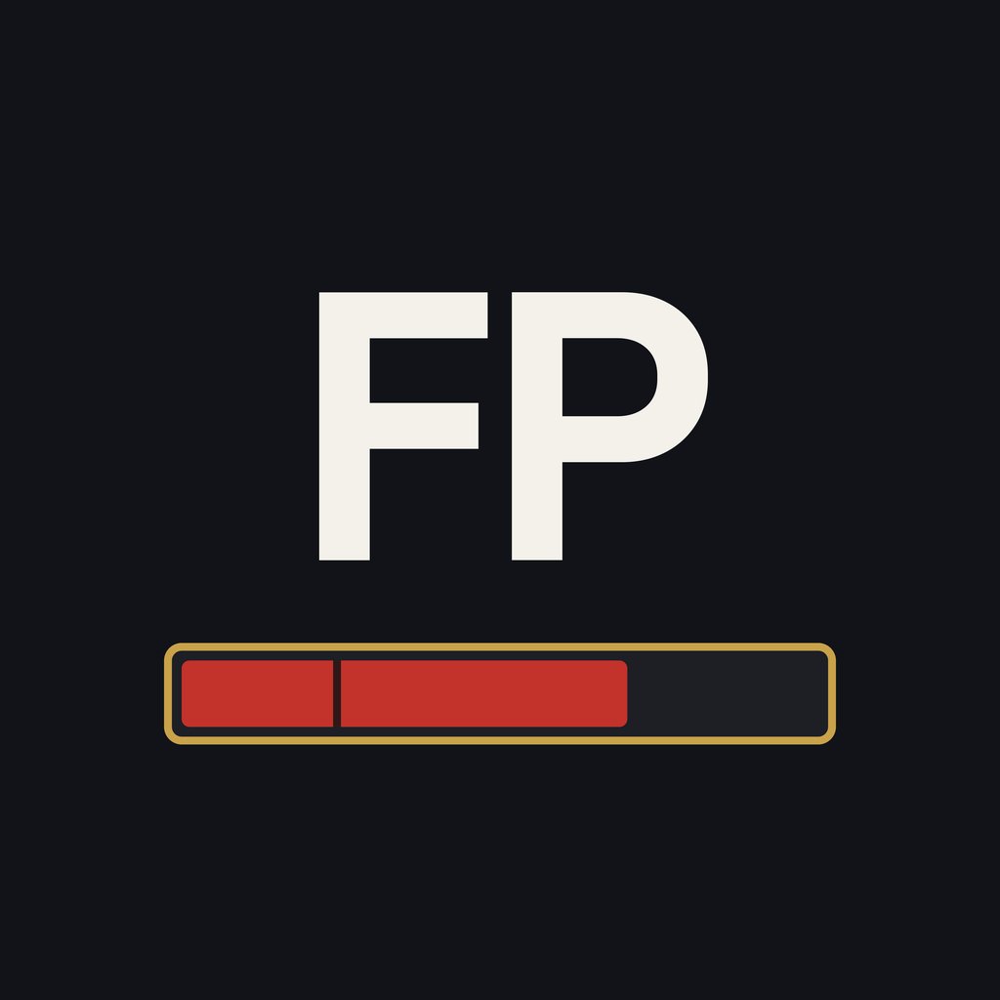
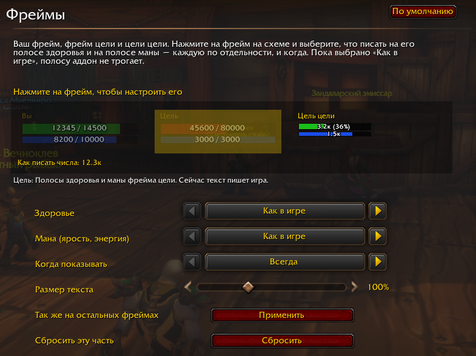

# ForeverPlatesPlus 0.14.0

Тонкая настройка стандартных неймплейтов WoW Forever в их родном стиле — и, по желанию, текста на фреймах игрока и цели. Аддон ничего не перерисовывает: он выставляет встроенные настройки игры, добавляет несколько элементов к стандартным неймплейтам и даёт подогнать размер, прозрачность и место каждой части.

Название аддона, папка и репозиторий на GitHub совпадают: `ForeverPlatesPlus`. До версии 0.13.0 аддон назывался ForeverPlates (ещё раньше — Forever Plates+): если в `AddOns` осталась старая папка `ForeverPlates`, удалите её, иначе в игре будут работать оба аддона сразу.

| Враг | Союзник | Фреймы |
|---|---|---|
|  |  |  |

## Установка

Распакуйте папку `ForeverPlatesPlus` в `World of Warcraft\_forever_\Interface\AddOns\` (там же, где лежат другие аддоны Forever). Отключите Plater: два аддона неймплейтов мешают друг другу.

## Как устроены настройки

`Esc → Настройки → Модификации → ForeverPlatesPlus`, `/fpl`, кнопка у миникарты (клик — настройки, перетаскивание — переместить) или кнопка аддонов рядом с миникартой.

- **ForeverPlatesPlus** (главная) — пресет и сброс своих правок; **«Мои пресеты»** — сохранить текущие настройки под своим именем и применить их на любом другом персонаже (общие для всего аккаунта); кнопка у миникарты, управление настройками игры и то, что общее для всех неймплейтов: показывать ли их всегда, держать ли у края экрана, бледнеют ли за препятствиями.
- Дальше страницы по категориям. **Первая строка каждой — её включение**: выключите — и аддон эту часть не трогает, всё как в игре (и настройки игры для неё возвращаются к стандартным), остальные пункты страницы скрыты.

| Страница | Первая строка | Основное | Схема (нажмите на часть) |
|---|---|---|---|
| **Враг** | Менять неймплейты врагов | дальность появления, раздвигать ли, гильдия, «!» задания, бледнеть вне досягаемости и не в цели | весь неймплейт (прислужники, мелкие мобы), имя, гильдия, цифры здоровья, отметка задания |
| **Союзник** | Менять неймплейты союзников | как показывать (только имя или с полоской), гильдия | весь неймплейт (раздвигать ли, дружественные NPC), имя, гильдия, цифры здоровья |
| **Питомец союзника** | Питомцы союзников: только имя | имя хозяина под питомцем | имя, хозяин |
| **Баффы и дебаффы** | Менять баффы и дебаффы | мои дебаффы, баффы для снятия, дебаффы для рассеивания | у врагов: мои дебаффы, баффы для снятия, значки игры; у союзников: дебаффы для рассеивания, значки игры |
| **Агро** | Предупреждать об агро заранее | порог, пульсация, картинка «как это выглядит», подсветка агро игры | — |
| **Каст** | Менять полосу каста | таймер, серая полоса без прерывания, настройки полосы каста игры | название заклинания, время каста |
| **Фреймы** | Менять текст на фреймах | как писать числа | ваш фрейм, цель, цель цели |

На схеме: нажимаете на часть — и под схемой остаются только её настройки: цвет, размер, непрозрачность, сдвиг, место и всё, что к ней относится. Выключенные части нарисованы бледно, подсказка под схемой говорит, где их включить. Кнопки: «Сбросить основное» и «Сбросить эту часть».

На фреймах пока у полосы стоит «Как в игре» (так по умолчанию), аддон её не трогает: выберите формат — и он сразу появится.

## Что делает базовый пресет

**Враг**
- обычно видны только уровень и имя; под курсором — число здоровья; в цели — число и проценты; число сокращается до тысяч с одним знаком: 12.3к;
- имена на 15% крупнее игровых и пишутся целиком, без многоточия; название заклинания и таймер каста тоже на 15% крупнее;
- имя — там, где его пишет стиль неймплейтов игры (можно перенести над полосой или внутрь неё);
- жёлтый «!» слева от полоски у мобов и NPC, нужных для ваших заданий; баффы игры встают за ним, а без него прижимаются к полоске;
- над именем — ваши дебаффы с таймером и баффы, которые можно снять (в синей рамке); значки игры: важные баффы мобов и вражеских игроков (PvP) слева, контроль справа;
- оставшееся время каста справа от полосы; полоса серая, пока ваше прерывание на перезарядке;
- враги вне досягаемости основного умения класса (у жреца — «Кара») бледнеют до 50%; вражеские неймплейты раздвигаются, а не накладываются;
- подсветка угрозы игры — нарастающая; предупреждение заранее: в группе над врагом разгорается и мягко пульсирует жёлтое свечение, когда ваша угроза подходит к срыву (с 70%), танку не показывается;
- гильдия вражеских игроков — по желанию (выключено).

**Союзник**
- галочка «Менять неймплейты союзников» (включена): выключите — и неймплейты союзных игроков и дружественных NPC будут полностью как в игре, вместе с настройками игры для них;
- только белым полупрозрачным именем (55%), без полоски и чисел, везде; цвет — класса, белый или свой;
- дебаффы, которые вы можете снять, — маленькими значками над именем;
- гильдия — по желанию (выключено);
- в подземельях и рейдах игра не даёт аддонам менять неймплейты союзников: там работают только «только имя» и цвет класса (это настройки самой игры).

**Питомец союзника**
- вместо больших подписей «<Питомец …>» над головой — имя, цветом как у союзников: белые имена союзников — белый, цвет класса — цвет класса хозяина (если хозяина не видно рядом и он не в группе — белым); под ним мелко — имя хозяина целиком, с фамилией; в подземельях и рейдах питомцы скрыты.

**Фреймы** — все полосы как в игре. Выберите формат у нужной полосы, например «Текущее» у здоровья цели, — и он сразу появится.

## Пресет жреца

Всё из базы плюс подготовленная отметка добивания для «Слова Тьмы: Смерть». Она скрыта (это узкая вещь): `/fpl killzone` включает её, после `/reload` появляется страница «Добивание». Тонкая тёмная черта на полоске здоровья врага: когда здоровье опускается левее неё, SW:D убьёт цель. Видна только в бою и только на цели. Место черты берётся из описания SW:D (нижняя граница урона), поэтому растёт вместе с силой заклинаний; если описание прочитать не удалось — 350 или ваше число. Вторая, бледная черта — «убьёт при крите». Вместо черты можно закрасить всю зону. Настроили — сохраните в «Мои пресеты», чтобы перенести на другого жреца.

## Команды

Любую настройку можно поменять: ваши правки хранятся поверх пресета, кнопка «Сбросить» на главной возвращает пресет целиком.

Команды:
- `/fpl` — открыть настройки
- `/fpl preset auto|base|priest` — пресет («auto» = по классу)
- `/fpl killzone` — включить или выключить скрытую отметку добивания (страница «Добивание» — после `/reload`)
- `/fpl kz 420` — порог отметки добивания числом (вручную)
- `/fpl kzspell <ID или название>` — брать порог из описания другого умения
- `/fpl reset` — сбросить свои правки
- `/fpl debug` — навести курсор на неймплейт (или взять в цель) и набрать: что аддон видит на нём (для диагностики)
- `/fpl status` — текущий пресет и число правок
- `/fpl gamedefaults` — вернуть настройки неймплейтов игры к стандартным и перестать ими управлять

## Как добавить класс

В `Presets.lua` добавьте таблицу в `ns.ClassPresets` с именем класса (`WARRIOR`, `MAGE`, …) и только теми ключами, которые отличаются от базы, а также строку в `ns.PresetOrder` / `ns.PresetLabelKey`.

## Ограничения игры

- Неймплейты союзников внутри подземелий игра не даёт менять аддонам — там они стандартные.
- Здоровье и ауры в Forever аддоны могут показывать, но не читать. Поэтому зона добивания рисуется полоской (игра сама считает ширину), а ауры показываются через встроенные контейнеры аур.
- Если клиент показывает здоровье вражеских игроков только в процентах (0–100), зона добивания по числу на них скрывается.
- Настройки игры меняются только вне боя; изменения в бою применятся после него.
- Кто сбил каст, аддон показать не может: журнал боя в Forever аддонам недоступен.
- Время каста и состояние прерывания в подземельях могут быть скрыты игрой: тогда таймера нет, а серая полоса рисуется самой игрой по скрытым данным.

## Версии

Версия — три числа `X.Y.Z` (в `ForeverPlatesPlus.toc`, строка `## Version`, и в заголовке этого файла):
- **Z** (после второй точки) — исправления и мелкие доработки без новых настроек: 0.11.0 → 0.11.1;
- **Y** (после первой точки) — новые возможности или новые настройки: 0.11.1 → 0.12.0, Z обнуляется;
- **X** — большие переделки, после которых старые настройки не переносятся или аддон ведёт себя заметно иначе; 0 — пока аддон в разработке, первая «готовая» версия будет 1.0.0.

Каждое изменение: поднять версию по этому правилу и добавить строку в `CHANGELOG.md`.

## Разработка

Корень репозитория — это сама папка аддона: его можно склонировать прямо в `World of Warcraft\_forever_\Interface\AddOns\ForeverPlatesPlus`.

- `*.lua`, `ForeverPlatesPlus.toc` — аддон. Новый файл нужно добавить в `.toc`, иначе игра его не загрузит (и после этого нужен перезапуск игры, `/reload` не хватит).
- `Presets.lua` — все настройки по умолчанию (`ns.BASE`) и пресеты классов (`ns.ClassPresets`).
- `Look.lua` — внешний вид частей неймплейта: ключи `look.<часть>.<scale|alpha|x|y|place|color|rgb>`; `LookPreview.lua` — схемы на страницах «Враг», «Союзник», «Питомец союзника»; `Options.lua` — сами страницы (у каждой части свои пункты, видимые только когда она выбрана). Сдвиги частей игры ставятся через `ns.PlaceRegion`: он не даёт сдвигам накапливаться, когда игра заново раскладывает неймплейт.
- `UnitFrames.lua` — текст на полосах фреймов игрока, цели и цели цели (блок «Фреймы»).
- `tests/` — проверка без игры: `mock.lua` изображает API WoW, `run_tests.py` гоняет аддон через сценарии.
  Запуск: `pip install lupa`, затем `python3 tests/run_tests.py . tests` — в конце должно быть `FAILURES: 0`.
  Игре эта папка не мешает.
- Выпуск: тег с номером версии (`git tag 0.13.1 && git push origin 0.13.1`) запускает `.github/workflows/release.yml`: тесты, сборка архива по `.pkgmeta`, загрузка в GitHub Releases и на CurseForge. Для CurseForge нужны секрет репозитория `CF_API_KEY` (API-токен CurseForge) и строка `## X-Curse-Project-ID: <номер проекта>` в `ForeverPlatesPlus.toc`; без них архив попадает только в GitHub Releases.
- `TODO.md` — что сделать в следующих версиях.
- `RELEASE_NOTES.md` — патчноуты текущей версии для игроков, на английском и русском: их выкладка отправляет на CurseForge. Перед каждым выпуском переписываются под новую версию (полная история — в `CHANGELOG.md`).
- `media/` — скриншоты для README и CurseForge, `CURSEFORGE.md` — текст страницы на CurseForge. В архив аддона не попадают (список исключений — в `.pkgmeta`).

Правила, которые держат аддон рабочим в Forever:
- здоровье, угроза и часть данных о юнитах могут быть «секретными»: их нельзя сравнивать и считать в Lua, только передавать в функции игры (`StatusBar:SetValue`, `AbbreviateNumbers`, `SetText`);
- неймплейты союзников в подземельях и рейдах закрыты для аддонов — там работают только настройки самой игры (CVar);
- всё, что аддон меняет, должно выключаться в настройках.
